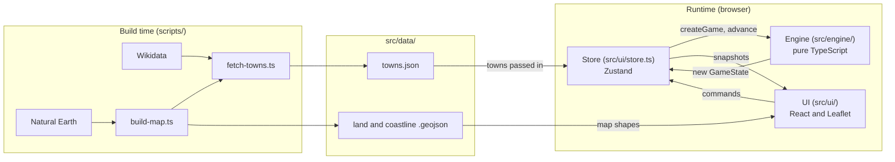
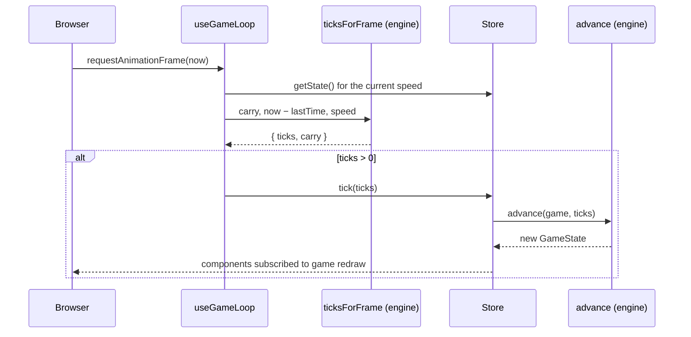

# Architecture

How Freightline is put together: the layers, the rules between them, the shape of the game state, and the decisions behind them. [GAME_DESIGN.md](GAME_DESIGN.md) says what the game does and why; this document says how the code does it.

Written at the end of Sprint 1 (10 November 2026). Update it in the same PR as any change that breaks something stated here.

## Overview



Three layers run in the browser, and one runs only when the data is rebuilt:

| Layer         | Folder            | Does                                                                                                  | Must not                                                                   |
| ------------- | ----------------- | ----------------------------------------------------------------------------------------------------- | -------------------------------------------------------------------------- |
| Engine        | `src/engine/`     | All game rules: time, money, towns, distances, scenarios. Pure functions from one state to the next   | Import React, touch the DOM, read the system clock or call `Math.random()` |
| Store         | `src/ui/store.ts` | Holds the current `GameState` and the speed setting; turns UI commands into engine calls              | Contain game rules                                                         |
| UI            | `src/ui/`         | Draws the top bar, controls and map from store snapshots; sends commands                              | Change game state directly, or format money and dates outside `format.ts`  |
| Data pipeline | `scripts/`        | Downloads and processes town and map data into `src/data/`                                            | Run in the browser                                                         |
| Platform      | `src/platform/`   | Planned: `SaveStore` and `PlatformServices` interfaces, so the desktop build can swap implementations | (empty until S3-4)                                                         |

## The engine

### Rules, and how they're enforced

| Rule                                                                       | Enforced by                                                                                      |
| -------------------------------------------------------------------------- | ------------------------------------------------------------------------------------------------ |
| No React imports                                                           | `no-restricted-imports` in `eslint.config.js`                                                    |
| No browser APIs (`window`, `document`, `localStorage`)                     | `no-restricted-globals`                                                                          |
| No real time (`Date.now()`, `new Date()` with no arguments, `performance`) | `no-restricted-properties` and `no-restricted-syntax`                                            |
| No unseeded randomness (`Math.random()`)                                   | `no-restricted-properties`                                                                       |
| The lint rules themselves work                                             | `tests/lint/engine-rules.test.ts` lints sample code with ESLint's Node API                       |
| State is never mutated                                                     | `readonly` on every field and array; tests check the original state is unchanged after `advance` |
| Money is whole minor units                                                 | The `Money` type (`amount` plus `currency`); formatting divides by 100 only in `format.ts`       |
| Balancing numbers live in one place                                        | `balance.ts`, declared `as const` so nothing can reassign them                                   |

### Modules

| File           | Holds                                                                              |
| -------------- | ---------------------------------------------------------------------------------- |
| `state.ts`     | `GameState`, `Company`, `Depot`; `createGame`, `advance`, `currentCalendarMinutes` |
| `scenarios.ts` | The `Scenario` type and `plymouthSandbox`                                          |
| `world.ts`     | The `Town` type; `findTown`, `depotTowns`                                          |
| `distance.ts`  | `greatCircleKm` (haversine, IUGG mean radius) and `roadKm` (× `world.roadFactor`)  |
| `time.ts`      | `toCalendarMinutes`: a UTC calendar date to absolute minutes                       |
| `clock.ts`     | `Speed` and `ticksForFrame`: real frame time to whole game ticks                   |
| `random.ts`    | `seedRandom` and `nextRandom` (mulberry32)                                         |
| `money.ts`     | `Money` and `CurrencyCode`                                                         |
| `balance.ts`   | Tuning constants                                                                   |

### State shape

As of Sprint 2:

```ts
interface GameState {
  readonly startTime: number; // calendar minutes (UTC) when the game began
  readonly minutes: number; // game minutes elapsed since startTime
  readonly rngState: number; // seeded generator state, saved with the game
  readonly company: Company;
  readonly towns: readonly Town[]; // towns within the job radius of the start town
}

interface Company {
  readonly name: string;
  readonly cash: Money; // { amount: whole minor units, currency: "GBP" }
  readonly depots: readonly Depot[]; // one in v0.1, but always a list
  readonly vehicles: readonly Vehicle[]; // one in v0.1, but always a list
}

interface Depot {
  readonly id: string;
  readonly townId: string; // a Wikidata Q-number
}

interface Vehicle {
  readonly id: string;
  readonly modelId: VehicleModelId;
  readonly homeDepotId: string;
  readonly townId: string;
  readonly status: VehicleStatus;
}
```

Planned additions, each from a Ready issue:

| Field                                 | Issue    | Notes                                                                                                   |
| ------------------------------------- | -------- | ------------------------------------------------------------------------------------------------------- |
| Job board offers and a job id counter | #51, #52 | Ids come from a counter, not randomness, so equal inputs give equal games                               |
| Trips as a list of legs               | #55      | Stage end times stored when a job is accepted; status and position are worked out from the current time |
| Ledger                                | #57      | Append-only; cash changes only through entries                                                          |
| Bankruptcy countdown and game-over    | #59      | The failure rule comes from the scenario                                                                |

### Creating a game

`createGame(scenario, towns)` builds the first state from two inputs:

- **The scenario** holds every start value: company name, start town (by Wikidata id), start time, starting cash and seed. Nothing in the engine names Plymouth except `plymouthSandbox`.
- **The towns** are passed in, not imported. The engine filters them to the job radius around the start town, so tests use three invented towns, and the UI decides how data is loaded.

### Advancing time

`advance(state, ticks)` returns a new state. One tick is one game minute. From #52 onwards, `advance` processes ticks one at a time, and every rule that draws randomness or changes state does so per tick. The test that matters: advancing by 90 ticks at once must equal advancing by 30 and then 60, because the frame loop hands over however many ticks fit into each frame.

## Time

Two numbers make up the current moment:

| Value       | Meaning                                                      |
| ----------- | ------------------------------------------------------------ |
| `startTime` | Absolute minutes since 1 January 1970, **on a UTC calendar** |
| `minutes`   | Minutes elapsed since the game began                         |

`currentCalendarMinutes(state)` is `startTime + minutes`. Day boundaries are where that value is a multiple of 1,440, whatever time the scenario starts.

Display goes through `format.ts`, which formats in `timeZone: "UTC"` with `hourCycle: "h23"` and builds the string from `formatToParts`, so the output doesn't depend on a browser's punctuation choices.

## From frame to tick

The browser draws frames at its own rate; the engine moves in whole minutes. `useGameLoop` connects them:



- **Carry:** the fraction of a minute left over is passed into the next frame, so no game time is lost to rounding.
- **`FLOAT_TOLERANCE` (1e-9):** totals that should be whole minutes can land a hair below because `2.4` and `1000 / 60` aren't exact in binary. Tests at 2× and 30 fps caught this.
- **`MAX_FRAME_MS` (250):** browsers stop frames in hidden tabs, so the first frame back can claim minutes have passed. Capping each frame stops the game jumping ahead.
- **Negative gaps** are clamped to zero.
- **Speed lives in the store, not the engine.** It controls how fast ticks are fed in; it isn't part of the simulation, and a loaded save shouldn't start at 4×.

The loop reads the store with `getState()` inside the frame, rather than subscribing, so a speed change applies from the next frame without restarting the loop.

## The UI

- **Components subscribe to slices** of the store (`useGameStore((store) => store.game)`), and redraw only when that slice changes.
- **`MapView` creates the Leaflet map once** and reads towns and depots once, because nothing adds depots or towns mid-game in v0.1. #56 adds a store subscription for vans, which move every tick, and updates their markers in place rather than rebuilding the map.
- **Markers are drawn in code** (`circleMarker`), not images, so there are no assets to credit and no Vite image set-up.
- **Formatting** for money and dates is only in `format.ts`, with one `Intl` formatter per currency created once. `Record<CurrencyCode, …>` makes a new currency fail to compile until it has a formatter.

## The data pipeline

```text
npm run data:map    → src/data/land.geojson, src/data/coastline.geojson
npm run data:towns  → src/data/towns.json   (needs the map files first)
```

- **Settings** (centre, radius, minimum population, coast margin, maximum snap distance) are in `scripts/places.config.json`, checked by `parseConfig`.
- **Towns** come from a Wikidata SPARQL query, grouped by Q-number, taking the latest population figure, and sorted by population.
- **Map shapes** come from Natural Earth 1:10m, clipped to the play area and simplified.
- **Snapping:** any town outside the land shape is moved to the nearest coastline point plus a small inland margin, and the script fails if a town would move more than the limit. `tests/data/towns.test.ts` checks every town in `towns.json` is on land.
- **Separate TypeScript projects:** `tsconfig.app.json` covers `src/` and `tests/`; `tsconfig.node.json` covers `scripts/` and `tests/scripts/`. Scripts never import game code, and the game never imports scripts.

## Quality gates

| Gate                                  | Where                                            |
| ------------------------------------- | ------------------------------------------------ |
| Lint, format check, type-check, tests | `ci.yml`, on every pull request and push to main |
| Build and deploy to GitHub Pages      | `deploy.yml`, on every push to main              |
| Main protected                        | Ruleset: pull requests only, squash merges only  |

## Decision records

### ADR-001: A pure engine with a thin UI

**Status:** Accepted · **Date:** 14 October 2026 · **Deciders:** Will

**Context.** A tycoon game is mostly rules: time, money, distances, jobs. Those rules need testing in isolation, and the project is a portfolio piece where separation of concerns is something to show.

**Decision.** All rules live in `src/engine/` as pure TypeScript: no React, DOM, real time or unseeded randomness. A Zustand store holds the current state and calls the engine; React components read from the store and send commands.

| Option                               | Testability                | Complexity   | Notes                                                              |
| ------------------------------------ | -------------------------- | ------------ | ------------------------------------------------------------------ |
| **Pure engine and a store (chosen)** | High: plain Vitest, no DOM | Medium       | Same engine can run headless, in a worker, or in a desktop wrapper |
| Rules inside React components        | Low: needs component tests | Low at first | Rules scatter across components; hard to reproduce a game          |
| A game framework or ECS library      | Medium                     | High         | More than a map-and-dashboard game needs                           |

**Consequences.** Every engine function is testable with plain inputs. Any game can be reproduced from a seed and a list of commands. The cost is a little ceremony: the UI can't take shortcuts, and every action needs a command. The boundary is enforced by lint (see the engine rules table), not just convention.

### ADR-002: Leaflet directly, not react-leaflet

**Status:** Accepted · **Date:** 22 October 2026 · **Deciders:** Will

**Context.** The plan named react-leaflet. During the #5 spike, react-leaflet turned out to be under the Hippocratic License, which restricts use and isn't compatible with keeping a paid release possible.

**Decision.** Use Leaflet (BSD-2-Clause) directly inside a `useEffect`, with cleanup that removes the map.

**Consequences.** No licence risk, and full control over when the map is created. The cost is writing the React integration by hand: creating the map once, cleaning it up (which `StrictMode` tests in development), and updating layers in place when state changes (#56).

### ADR-003: Wikidata for town data

**Status:** Accepted · **Date:** 20 October 2026 · **Deciders:** Will

**Context.** The plan named the GeoNames cities export (CC BY 4.0). Towns need permanent ids for saves, populations, and a licence that allows commercial use.

**Decision.** Query Wikidata (CC0) with SPARQL; use Q-numbers as town ids.

| Option                | Licence                         | Ids                  | Notes                                                       |
| --------------------- | ------------------------------- | -------------------- | ----------------------------------------------------------- |
| **Wikidata (chosen)** | CC0, no attribution required    | Q-numbers, permanent | Live query; the service is sometimes overloaded (502s seen) |
| GeoNames              | CC BY 4.0, attribution required | GeoNames ids         | Bulk file download, no query needed                         |

**Consequences.** Saves can refer to towns by Q-number forever. Regenerating the data also picks up any changes made on Wikidata since the last run, so diffs need checking. Wikidata is still listed in `CREDITS.md`.

### ADR-004: Game time on a UTC calendar

**Status:** Accepted · **Date:** 9 November 2026 · **Deciders:** Will

**Context.** The game has real dates (it starts on Monday 1 March 2027), and the top bar must not skip or repeat an hour when UK clocks change on 28 March 2027.

**Decision.** Store time as whole minutes on a UTC calendar: `startTime` from the scenario, plus `minutes` elapsed. Format for display in UTC.

| Option                            | Clock changes           | Day boundaries           | Notes                                                |
| --------------------------------- | ----------------------- | ------------------------ | ---------------------------------------------------- |
| **Absolute UTC minutes (chosen)** | None                    | `% 1440 === 0`           | Simple arithmetic; real weekdays and months          |
| Minutes since game start          | None                    | Offset by the start time | Every daily rule needs correcting for the start hour |
| `Date` objects in local time      | Skips and repeats hours | Varies                   | Mutable, time-zone dependent, banned in the engine   |

**Consequences.** Daily, weekly and monthly rules (rent, autosave, finance weeks) are simple modulo checks. The game calendar is UTC by definition, so "08:00" in the game isn't tied to any real time zone.

### ADR-005: Fixed one-minute ticks fed from the frame loop

**Status:** Accepted · **Date:** 9 November 2026 · **Deciders:** Will

**Context.** The browser's frame rate varies (30 to 165 fps or more) and stops in hidden tabs. The simulation must give the same result whatever the frame rate.

**Decision.** The engine only advances in whole one-minute ticks. A pure function, `ticksForFrame`, converts each frame's real elapsed time into ticks, carrying the remainder, with a float tolerance and a 250 ms cap per frame.

**Consequences.** The simulation is identical at any frame rate or speed, and the conversion is unit-tested in the engine rather than in the browser. Rules must be written per tick, and `advance` must give the same result however ticks are chunked.

### ADR-006: Snap coastal towns onto land

**Status:** Accepted · **Date:** 10 November 2026 · **Deciders:** Will · **Spike:** #29

**Context.** The Natural Earth 1:10m coastline is smoothed. Five towns (Exmouth, Saltash, Dawlish, Seaton, Budleigh Salterton) fell a few hundred metres into the sea, Saltash visibly so.

**Decision.** The towns script moves any town outside the land shape to the nearest coastline point plus an inland margin (0.3 km), failing if a town would move more than 2 km.

| Option                            | Effort                                     | Data size   | Notes                                             |
| --------------------------------- | ------------------------------------------ | ----------- | ------------------------------------------------- |
| **Snap towns (chosen)**           | Small: one function and a test             | Unchanged   | Positions move under 1 km, invisible at play zoom |
| A finer coastline (OpenStreetMap) | Large: new source, scripts, licence (ODbL) | Much larger | Best detail; may be needed when the map grows     |
| Accept it                         | None                                       | Unchanged   | Markers visibly in the water                      |

**Consequences.** Every town is on land, guarded by a data test. The coastline's smoothing is still visible when zoomed right in. Revisit when the map grows beyond Devon and Cornwall.
